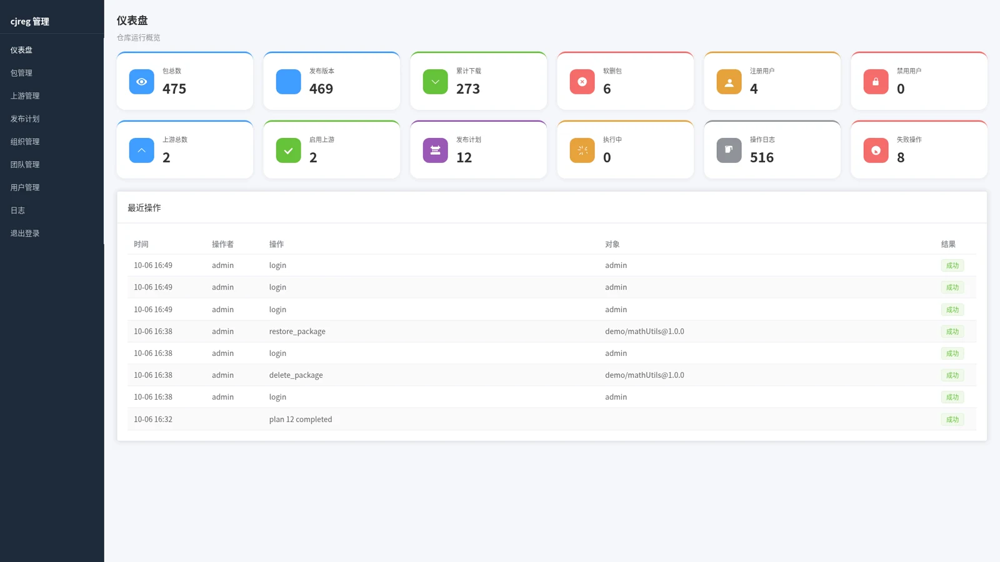

# cjreg

**仓颉私有中心仓** —— 用仓颉写的单二进制 registry，给 `cjpm` 提供私有包托管、多上游代理、依赖拓扑发布计划与 Web 管理后台。官方中心仓协议互通，客户端零改动。

[文档站](https://ystyle.top/cjreg/) · [快速开始](https://ystyle.top/cjreg/guide/) · [部署指南](https://ystyle.top/cjreg/deploy/) · [API 一览](https://ystyle.top/cjreg/api/) · [演示视频](https://www.bilibili.com/video/BV1e9pw6WELk/)



## 特性

- **官方协议互通**：`POST /pkg`、`GET /pkg/:name/:version`、`GET /index/:mo/:du/:name` 与官方中心仓一致，`cangjie-repo.toml` 改个地址就能用。
- **认证与权限**：pbkdf2 口令 + 会话 / 发布双 Token；权限取「包名所有者」与「团队授权」的较大者，分 read / write / overwrite 三级。
- **多上游代理**：上游按 priority 组成多仓，索引与制品按需回源、按 TTL 缓存；`resolve` 诊断给出逐仓命中链路。
- **发布计划**：依赖拓扑排序（`graph-cj`，与 `cjdep` 同一实现）+ 四分类（需发布 / 版本可选 / 已存在 / 冲突），按序推送目标仓并校验 sha256，中断后可恢复。
- **Web 全栈**：管理后台（用户 / 组织 / 团队 / 包 / 上游 / 发布计划 / 审计）与公开门户（首页 / 包列表 / 包详情 / 个人门户）由自研 `cjxt` 渲染，无前端构建链。
- **备份可验证**：`admin backup` / `restore` 带行数与 sha256 校验，`admin dump` 只读导出，升级前后可逐表 diff。
- **单二进制**：内嵌 bstorm（badger-cj），数据目录即数据；静态编译、优雅关闭，发布与下载全程流式。

## 快速开始

**Docker（推荐，无需仓颉工具链）**

```shell
# 初始化：首个管理员 + 默认官方上游 + 生成 cjreg.toml（只需一次）
docker run --rm -v ~/cjreg/data:/data ghcr.io/ystyle/cjreg:latest \
  /app/cjreg init -d /data --username admin --password '<你的口令>'

# 启动
docker run -d --name cjreg -p 8060:8060 -v ~/cjreg/data:/data --restart unless-stopped \
  ghcr.io/ystyle/cjreg:latest
```

用户门户 <http://localhost:8060/>，管理后台 <http://localhost:8060/admin>。

**源码构建（Compose 一键部署）**

```shell
git clone https://atomgit.com/ystyle/cjreg && cd cjreg
export ADMIN_PASS=='<你的口令>'
bash scripts/docker-deploy.sh    # 编译 → 构建镜像 → init → 启动 → 健康检查
```

**裸机部署**

```shell
eval "$(cjvs env zsh)" && eval "$(cjvs stdx-env zsh)"
cjpm build -j 16
./target/release/bin/ystyle::cjreg init -d ./data --username admin --password '<你的口令>'
./target/release/bin/ystyle::cjreg serve -p 8060 -d ./data
```

**客户端接入**

在项目根目录写 `cangjie-repo.toml`（Token 从门户「我的」页面获取）：

```toml
[repository.home]
registry = "http://192.168.1.10:8060"
token = "<发布 Token>"
```

之后 `cjpm build` 从私有仓解析依赖，`cjpm publish` 把包发到这里。

## 文档

在线文档站：<https://ystyle.top/cjreg/>（源码在 `docs-site/`，由 `.github/workflows/docs-deploy.yml` 自动部署）

| 主题 | 页面 |
|---|---|
| 安装与运行 | [安装与运行](https://ystyle.top/cjreg/guide/install) |
| 发布自己的包 | [发布包](https://ystyle.top/cjreg/guide/publish) |
| 权限、团队与组织 | [权限模型](https://ystyle.top/cjreg/guide/permission) · [团队与组织](https://ystyle.top/cjreg/guide/teams) |
| 上游代理与多仓 | [上游代理与多仓](https://ystyle.top/cjreg/guide/upstream) |
| 推包到目标仓 | [发布计划](https://ystyle.top/cjreg/guide/publish-plan) |
| 部署到服务器 | [部署指南](https://ystyle.top/cjreg/deploy/) · [Docker](https://ystyle.top/cjreg/deploy/docker) · [服务端配置](https://ystyle.top/cjreg/deploy/env) |
| 备份、恢复与升级 | [备份与恢复](https://ystyle.top/cjreg/guide/backup) |
| HTTP 接口 | [API 一览](https://ystyle.top/cjreg/api/) · [公开只读 API](https://ystyle.top/cjreg/guide/public-api) |
| 性能与内存 | [性能基准](https://ystyle.top/cjreg/guide/benchmark) · [内存与优雅关闭](https://ystyle.top/cjreg/guide/memory) |
| 排障 | [常见问题](https://ystyle.top/cjreg/guide/faq) |

面向开发者的仓内文档：[发版流程](docs/RELEASE.md) · [设计](docs/design.md) · [验证报告](docs/verification.md) · [审计日志](docs/audit-log.md)。

## 配套工具

围绕仓颉多仓体系，同作者维护了两个配套命令行工具，与本仓口径一致：

- **[cjdep](https://atomgit.com/ystyle/cjdep)** —— 依赖与「口径」工具：查某个包在当前 registry 上的最新版本、逐仓可解析情况，以及哪些包需要发布。对应本仓的 `/api/admin/resolve`。
- **[cjpm-ws](https://atomgit.com/ystyle/cjpm-ws)** —— cjpm workspace 工具：统一成员版本号，按依赖拓扑序批量发布。对应本仓的发布计划推送。

## 开发

```shell
eval "$(cjvs env zsh)" && eval "$(cjvs stdx-env zsh)"
cjpm build -j 16
cjpm test -j 16 --no-progress
./tests/e2e.sh    # 双仓 e2e：发布 → 拓扑分析 → 推送 → 校验
```

## License

MIT，见 [LICENSE](LICENSE)。
